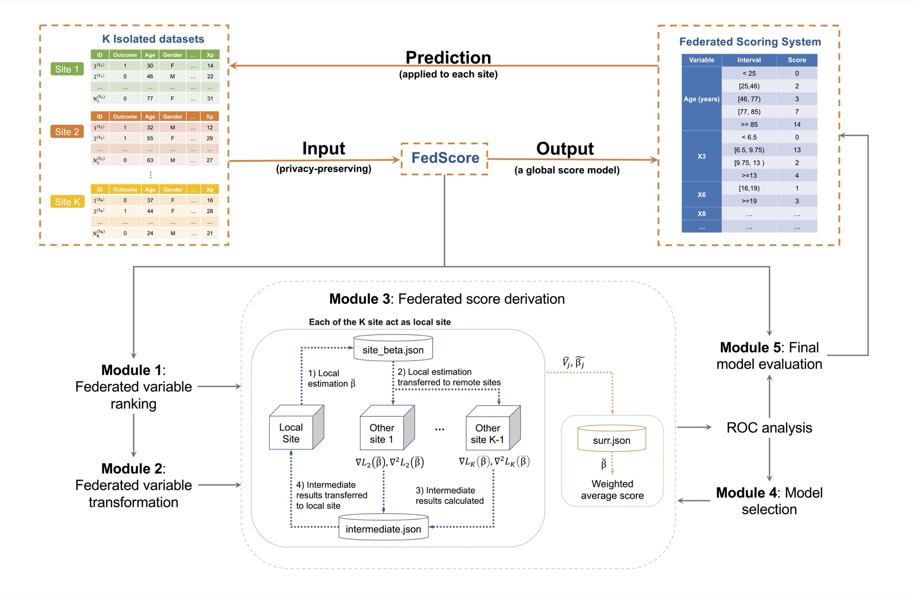
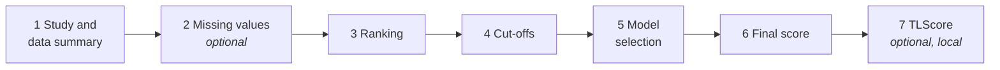
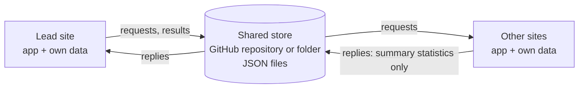

<h1 align="center">FedScore Shiny app</h1>

<p align="center">
  <b>Build interpretable point scores across hospitals without pooling patient data.</b><br>
  Binary and survival outcomes · federated missing-value imputation · every exchange auditable
</p>

<p align="center">
  <a href="LICENSE"></a>
  = 4.1" src="https://img.shields.io/badge/R-%E2%89%A5%204.1-276DC3.svg">
  <a href="../../actions/workflows/tests.yaml"></a>
  <a href="https://doi.org/10.1016/j.jbi.2023.104485"></a>
</p>

This app runs [FedScore](https://doi.org/10.1016/j.jbi.2023.104485) as a real multi-site
study:

* **Each site runs the app on its own computer, with its own data.**
* **Sites exchange only summary statistics.** These are small JSON files in a shared GitHub
  repository or a shared folder.
* **Together they build one [AutoScore](https://github.com/nliulab/AutoScore)-style point
  score,** for example "Age ≥ 76: +20 points".
* **Every site can check the score** on its own test set.

<p align="center"></p>

## Contents

* [Methods at a glance](#methods-at-a-glance)
* [Quick start](#quick-start)
* [Running a real study](#running-a-real-study)
* [What is shared, and privacy](#what-is-shared-and-privacy)
* [Methods in detail](#methods-in-detail)
* [Site data format](#site-data-format)
* [For developers](#for-developers)
* [Citation](#citation)

## Methods at a glance



| Step | Binary outcome | Survival outcome | Paper |
|---|---|---|---|
| Missing values *(optional)* | **FedIMPUTE**: federated imputation models; each site fills its own gaps | same | [Li et al., JBI 2025](https://doi.org/10.1016/j.jbi.2025.104780) |
| Variable ranking | random forest or univariable AUC, averaged across sites | random survival forest, averaged across sites | [FedScore](https://doi.org/10.1016/j.jbi.2023.104485), [AutoScore](https://doi.org/10.2196/21798), [AutoScore-Survival](https://doi.org/10.1016/j.jbi.2021.103959) |
| Cut-offs | site quantiles averaged into shared categories | same | [FedScore](https://doi.org/10.1016/j.jbi.2023.104485) |
| Federated model | **dCLR**: logistic model, site-specific baseline risk | **ODACH**: Cox model, site-specific baseline hazards | [dCLR](https://doi.org/10.1038/s41746-022-00615-8), [ODACH](https://doi.org/10.1038/s41598-022-09069-0) |
| | | **DiSAH**: additive hazards, site-specific baseline hazards, one round | [Wang et al., arXiv 2026](https://arxiv.org/abs/2601.14609) |
| Model selection | validation AUC (parsimony plot) | validation integrated AUC | [AutoScore](https://doi.org/10.2196/21798), [AutoScore-Survival](https://doi.org/10.1016/j.jbi.2021.103959) |
| Evaluation | AUC with 95% CI, operating point, ROC curve | iAUC, C-index with 95% CI, AUC(t) | |
| Local adaptation *(optional)* | **TLScore**: lasso correction at one site | TLScore for ODACH scores | |

All models keep a separate baseline for each site and share the covariate effects. This
suits real hospitals, whose patients and event rates differ. The survival workflow
follows [FedScore for survival outcomes](https://arxiv.org/abs/2403.05229).

## Quick start

**1. Install** R (≥ 4.1) and the packages:

```r
install.packages(c("shiny", "bslib", "ggplot2", "AutoScore", "pROC", "glmnet", "jsonlite",
                   "mice", "digest", "httr2"))
```

AutoScore brings in `randomForest`, `randomForestSRC`, `survival` and `survAUC`. There is no
C code to compile and no Python dependency.

**2. Run** from the folder that contains this repository:

```r
shiny::runApp("FedScore-ShinyApp")
```

**3. Try a two-site study on one computer.** Open the app in **two browser tabs**, one for each site:

| | Tab 1: site 1, the lead | Tab 2: site 2 |
|---|---|---|
| 1 | Pick a *site 1* demo and click **Connect** | |
| 2 | Enter `site1, site2`, check the outcome, click **Create study** | |
| 3 | | Pick the matching *site 2* demo and click **Connect** |
| 4 | Start each step in turn (tabs 2 to 6) | replies automatically |

There are three demo pairs:

| Demo | Outcome | Try |
|---|---|---|
| *Binary outcome* | binary | dCLR |
| *Survival outcome* | survival | ODACH or DiSAH |
| *Binary, with missing values* | binary | start with **2 · Missing values** |

`data-raw/make_demo_data.R` shows how each demo file was made.

## Running a real study

**Roles.** One site is the **lead**: it creates the study, starts each step and combines
the replies. Every site, the lead included, answers the requests from its own data.



**1. Set up the store.**
* **GitHub:**
  * Create a repository with at least one commit, for example a README. Use a private
    repository for real patient data; see [privacy](#what-is-shared-and-privacy).
  * Each site needs a [fine-grained personal access token](https://github.com/settings/personal-access-tokens)
    limited to that repository, with *Contents: Read and write*.
  * Every exchange becomes a commit, so the history is a full audit trail.
* **Shared folder:** a network drive, or a Dropbox, OneDrive or Box folder. Each site
  enters the path at which the folder appears on its computer.

**2. Agree** on a study name and on one short name per site (letters, digits, `-`, `_`).

**3. Connect.** Each site:
1. Starts the app *on its own computer*.
2. Loads its data.
3. Enters the store details, the study name and its site name.
4. Clicks **Connect**.

The lead clicks **Create study**, lists the sites, and chooses:
* the outcome;
* the site weights;
* the [minimum count](#what-is-shared-and-privacy).

**4. Run the steps.** The lead chooses each step's settings and starts it.
* **Automatic replies (default):** with *Reply and continue automatically* ticked, sites
  answer as soon as a request appears, and the lead moves on once everyone has replied.
* **Manual replies:** untick it to review each request first.
* **Progress card:** each step's card shows every round and every site's status.
* **Errors:** if a site can't answer, its error is shown there. For example, its test set
  may have no events.
* **Re-running a step** clears the later steps for every site.

**5. Use the results.** Every site sees:
* the ranking, cut-offs, parsimony plot and points table;
* the coefficients;
* every site's test performance.

Each site can download the points table and its own test-set scores, and can fit TLScore
locally.

> Run the app **locally** at each site. Hosting it on a server such as shinyapps.io would
> upload the site's data to that server.

To prefill the connection fields, set these environment variables, for example in
`.Renviron`:
* `FEDSCORE_STORE` (`folder` or `github`)
* `FEDSCORE_FOLDER`
* `FEDSCORE_REPO`, `FEDSCORE_BRANCH` and `FEDSCORE_DIR`
* `FEDSCORE_STUDY` and `FEDSCORE_SITE`

You can also set `GITHUB_PAT` for the token.

## What is shared, and privacy

| Step | Computed at each site | Shared |
|---|---|---|
| 1 · Study | checks its data | sample sizes, event counts, predictor names, types and categories, missing-value counts |
| 2 · Missing values | MICE completion; fitting and applying imputation models | coefficients, then gradients and Hessians, of each imputation model; never imputed values |
| 3 · Ranking | variable importance | rank of each variable |
| 4 · Cut-offs | quantiles | quantiles of continuous variables; levels of categorical ones |
| 5 · Model selection | federated fits for the top 1…m variables | estimates, variances, gradients and Hessians (DiSAH: summed estimating equations); validation AUC or iAUC |
| 6 · Final score | the same for the chosen model | the same, plus test-set performance and ROC or AUC(t) curve points |
| 7 · TLScore | lasso correction on its own data | nothing |

The **Exchange log** tab lists every file in the study and shows its contents.

Summary statistics are much less sensitive than patient records, but they are not
risk-free:

* **Minimum count** (default 10; 0 turns it off). A site refuses to share model statistics
  if any non-empty category of the model's variables has fewer patients than this. It also
  refuses to share performance on a validation or test set with fewer events or non-events
  than this. The refusal names the categories, so the lead can merge numeric categories on
  step 4. For an imputation model, a site with too few observed values simply sits that
  model out.
* **Where the files live.** In a **public** repository anyone can read every shared
  statistic. That suits demonstrations and open studies. For patient data, use a
  **private** repository or a shared folder, as approved by your data-governance and
  ethics processes.
* **Never shared:** patient-level rows, imputed values, the access token, and anything from
  TLScore.

## Methods in detail

<details>
<summary><b>Missing values: FedIMPUTE</b> (<a href="https://doi.org/10.1016/j.jbi.2025.104780">Li et al., JBI 2025</a>)</summary>

The app implements the DAC-MICE variant:

1. Each site completes its predictors with one MICE imputation. This uses only its own
   data, and never the outcome.
2. Each chosen variable gets an imputation model on the other predictors: linear for
   numeric variables, logistic for binary ones. Each model is federated:
   * Round 1: each site shares local coefficients, which are averaged.
   * Each further *Newton round*: each site shares gradients and Hessians at the current
     coefficients, and the lead takes a Newton step.
3. Each site fills its own missing values with the federated models:
   * the predicted value for numeric variables;
   * a random draw for binary ones.

   Optionally, each site first recalibrates the models on its own observed values
   (transfer learning).

All later steps use the completed data. Variables with more than two categories are not
imputed; their missing values form an "Unknown" category. If you skip this step, every
missing value forms an "Unknown" category.

Differences from the [FedIMPUTE code](https://github.com/flemergency/FedIMPUTE):
* Sites are weighted by their number of observed values, so one Newton round gives exactly
  the pooled linear model.
* The adaptive-lasso step is left out.
* Recalibration uses a cross-validated lasso.
</details>

<details>
<summary><b>Ranking and cut-offs</b> (<a href="https://doi.org/10.1016/j.jbi.2023.104485">FedScore</a>)</summary>

* **Ranking.** Each site ranks the variables by random-forest importance, by random survival
  forest importance (survival outcomes), or by univariable AUC. The federated rank is the
  weighted mean of the site ranks.
* **Cut-offs.** Each site shares quantiles of each continuous variable (default 5%, 20%, 80%
  and 95%). These are averaged with the site weights and rounded to 3 significant digits.
  A cut-off that equals a site's minimum or maximum is dropped, so no category is empty.
  The lead can fine-tune any variable's cut-offs.
</details>

<details>
<summary><b>dCLR: binary outcomes</b> (<a href="https://doi.org/10.1038/s41746-022-00615-8">Tong et al., npj Digit Med 2022</a>)</summary>

dCLR uses each site's pairwise conditional likelihood, so each site's baseline risk cancels
out. It runs in three rounds:
1. Local estimates and sandwich variances, combined into β̄ by inverse-variance weighting.
2. Gradients and Hessians at β̄.
3. Each site's surrogate estimate, combined by inverse-variance weighting.

*Surrogate passes* repeats rounds 2 and 3 around the new estimate. One pass is the
published one-shot method. Extra passes move the result toward the pooled-data fit, which
helps when a category is sparse at some site.
</details>

<details>
<summary><b>ODACH: Cox model for survival</b> (<a href="https://doi.org/10.1038/s41598-022-09069-0">Luo et al., Sci Rep 2022</a>)</summary>

ODACH is a Cox model stratified by site, using each site's Breslow partial likelihood. Its
rounds and surrogate passes are the same as dCLR's. Coefficients are log hazard ratios.
TLScore is available.
</details>

<details>
<summary><b>DiSAH: additive hazards for survival</b> (<a href="https://arxiv.org/abs/2601.14609">Wang et al., arXiv 2026</a>)</summary>

DiSAH fits the additive hazards model λ<sub>k</sub>(t) + xᵀβ with Lin and Ying's
estimating equations:
* In **one round**, each site shares three sums, `A`, `d` and `B`.
* β = (ΣA)⁻¹Σd. This is exactly the pooled stratified estimate, with a sandwich variance.
* Coefficients are hazard differences per unit of time.

The app implements the stratified estimator. The unstratified estimator needs every
patient's event time from every site, which this app does not share.
</details>

<details>
<summary><b>Score table, evaluation and TLScore</b></summary>

* **Points.** Within each variable the lowest-risk category gets 0 points. Points are
  scaled so the maximum total equals *Maximum total score* (default 100), as in AutoScore.
* **Binary evaluation:**
  * AUC with a DeLong 95% CI;
  * sensitivity and specificity at the Youden threshold;
  * ROC curve.
* **Survival evaluation** (as in AutoScore-Survival):
  * integrated AUC (Uno's AUC weighted by the Kaplan–Meier drop);
  * Harrell's C-index with a 95% CI;
  * Uno's AUC(t) at times chosen by the lead. By default these are the quartiles of the
    lead site's event times.
* **TLScore** fits a lasso correction δ on one site's training data, with the federated
  linear predictor as an offset: β<sub>TL</sub> = β<sub>fed</sub> + δ. It is available for
  dCLR and ODACH scores.
* **Site weights.** Derivatives, ranks and quantiles are combined with the weights chosen
  when the study is created: by training size, or equal.
</details>

## Site data format

A site's data is one `.rds` file holding one of these:
* a list with `train`, `validate` and `test` data frames (also accepted: `train_set`,
  `validation`, `validation_set`, `test_set`);
* a list with a `non_cv` element in that format; or
* a single data frame, split 70/10/20.

The outcome columns:

| Outcome | Columns |
|---|---|
| Binary | `label`: logical, 0/1 or a two-level factor |
| Survival | `label_time`: follow-up time (≥ 0); `label_status`: event indicator (logical or 0/1) |

All other columns are predictors and may contain missing values. Character columns are
treated as categorical. Only columns present at every site, with the same type, are used.

## For developers

<details>
<summary><b>Code layout</b></summary>

| File | Contents |
|---|---|
| `app.R` | user interface and server |
| `R/fed_store.R` | folder and GitHub stores |
| `R/fed_protocol.R` | requests, replies, and how the lead combines them |
| `R/fed_data.R` | loading and checking site data |
| `R/fed_impute.R` | FedIMPUTE |
| `R/fed_prep.R` | ranking and cut-offs |
| `R/fed_model.R` | likelihoods: dCLR, ODACH (Cox) and DiSAH (additive hazards) |
| `R/fed_score.R` | score tables, evaluation and TLScore |
| `data-raw/make_demo_data.R` | how the demo data was made |
</details>

<details>
<summary><b>Files in the store</b></summary>

```
<study>/study.json                   lead site, sites, outcome (written by the lead)
<study>/<step>/round<k>.json         the lead's request k of a step
<study>/<step>/round<k>_<site>.json  each site's reply to request k
<study>/<step>/result.json           the outcome of the step (written by the lead)
```

Each site writes only its own reply files, so sites never overwrite each other's files.
Every request carries the id of its step run, and replies to an older run are ignored.
The app checks the store every 3 seconds (folder) or 10 seconds (GitHub).
</details>

<details>
<summary><b>Tests</b></summary>

```r
testthat::test_dir("FedScore-ShinyApp/tests/testthat")
```

The tests run on GitHub Actions for every push and pull request. They check:
* **Reference implementations:**
  * the pairwise likelihood matches a line-by-line port of FedScore's original C code;
  * the Cox likelihood matches `survival::coxph` (Breslow ties);
  * the additive-hazards sums match DiSAH's own `V_k()`;
  * the survival metrics match AutoScore's.
* **Complete studies through a store** match the pooled-data fits:
  * dCLR matches the pooled pairwise fit (within 0.001);
  * ODACH matches pooled stratified `coxph` (within 0.001);
  * DiSAH matches the pooled stratified estimate exactly;
  * FedIMPUTE's linear models match pooled least squares.
* **Both stores** round-trip JSON. The GitHub store is tested against a mock of the API,
  including a write conflict between two sites.
* **Error handling:** error and stale replies, restarted steps, and the minimum-count check.
* **The whole app,** via `shiny::testServer`:
  * binary, survival and imputation studies run with the app as the lead site;
  * a non-lead site can only reply.

Tested with R 4.4, with shiny 1.10/bslib 0.8 and with shiny 1.13/bslib 0.10.
</details>

<details>
<summary><b>Size and speed</b></summary>

A dCLR study with 5 sites and all 20 demo variables in the parsimony analysis took about
2.5 minutes, added up over all sites. Real sites work in parallel. The largest file was
about 1 MB. GitHub's blob API, which the app uses to download files, supports up to 100 MB.
</details>

<details>
<summary><b>Changes from the earlier prototype</b></summary>

This app replaces the prototype scripts (`shinyapp*.R`) on the `ShinyApp` branch of the
FedScore repository.

**Bugs fixed:**
* **Sites were not separate.** The prototype loaded every site's data into one R session.
  Now each site runs its own copy and exchanges JSON through a shared store.
* **dCLR did not federate.** It read the lead site's gradient file K times instead of
  averaging across sites. FedScore's survival scripts have the same bug in their ODACH
  surrogate step; here, all sites' derivatives are averaged.
* **Score tables subtracted one global minimum, including the intercept.** Points are now
  set within each variable.
* **Cut-offs were floored to integers,** which collapsed categories.
* **Sites could end up with different factor levels.**
* **TLScore read a file the dCLR path never writes.**
* **The parsimony plot never scored the validation sets.**

**Dependencies removed:**
* The hand-compiled C likelihoods and Nelder–Mead are replaced by exact vectorised
  derivatives with Newton steps.
* The prototype's RStudio and Python requirements are gone.

**Algorithms removed:** ODAL2, which assumes all sites share one baseline risk.
</details>

## Citation

If you use this app, please cite FedScore and the methods you used:

* **FedScore:** Li, S., Ning, Y., Ong, M.E.H., Chakraborty, B., Hong, C., Xie, F., … Liu, N. (2023). FedScore: A privacy-preserving framework for federated scoring system development. *Journal of Biomedical Informatics*, 104485. https://doi.org/10.1016/j.jbi.2023.104485
* **FedScore for survival outcomes:** Li, S., Shang, Y., Wang, Z., Wu, Q., Hong, C., Ning, Y., … Liu, N. (2024). Developing federated time-to-event scores using heterogeneous real-world survival data. arXiv:2403.05229. https://arxiv.org/abs/2403.05229
* **FedIMPUTE:** Li, S., et al. (2025). FedIMPUTE: Privacy-preserving missing value imputation for multi-site heterogeneous electronic health records. *Journal of Biomedical Informatics*, 104780. https://doi.org/10.1016/j.jbi.2025.104780
* **dCLR:** Tong, J., et al. (2022). Distributed learning for heterogeneous clinical data with application to integrating COVID-19 data across 230 sites. *npj Digital Medicine*, 5, 76. https://doi.org/10.1038/s41746-022-00615-8
* **ODACH:** Luo, C., et al. (2022). ODACH: a one-shot distributed algorithm for Cox model with heterogeneous multi-center data. *Scientific Reports*, 12, 6627. https://doi.org/10.1038/s41598-022-09069-0
* **DiSAH:** Wang, Z., Li, S., Ong, M.E.H., & Liu, N. (2026). Communication-efficient distributed hazard difference estimation for heterogeneous multi-site survival data. arXiv:2601.14609. https://arxiv.org/abs/2601.14609
* **AutoScore:** Xie, F., Chakraborty, B., Ong, M.E.H., Goldstein, B.A., & Liu, N. (2020). AutoScore: A machine learning–based automatic clinical score generator and its application to mortality prediction using electronic health records. *JMIR Medical Informatics*, 8(10), e21798. https://doi.org/10.2196/21798
* **AutoScore-Survival:** Xie, F., et al. (2022). AutoScore-Survival: Developing interpretable machine learning–based time-to-event scores with right-censored survival data. *Journal of Biomedical Informatics*, 125, 103959. https://doi.org/10.1016/j.jbi.2021.103959

## License

GPL-3, the same as AutoScore and shiny. See [`LICENSE`](LICENSE).
